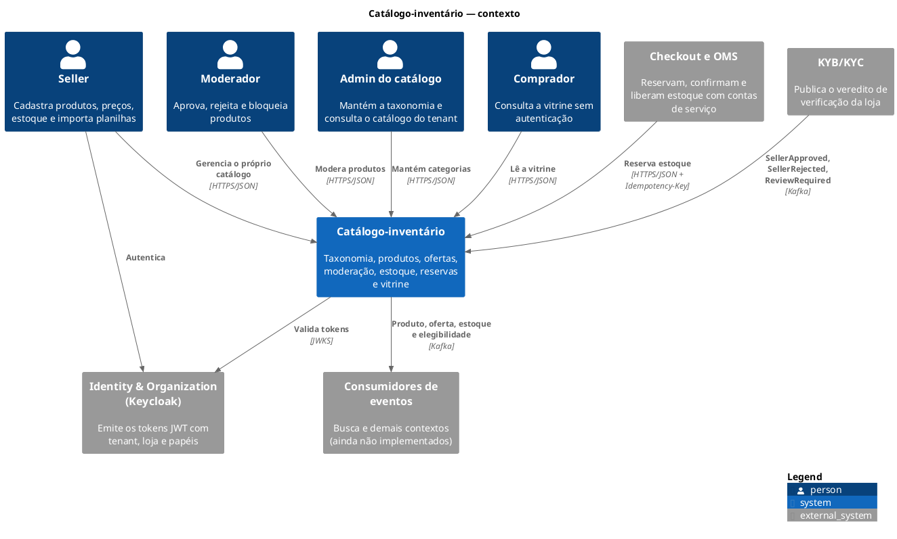

# Catálogo-inventário

Contexto do marketplace responsável pelo que um seller vende e por quanto pode vender. Ele mantém a taxonomia de categorias, os produtos e seus SKUs, as ofertas com preço e promoções, a moderação, a vitrine pública, o saldo de estoque e as reservas usadas pelo checkout. Cada tenant enxerga apenas os próprios dados, e tenant e loja vêm sempre do token JWT validado.

Este arquivo é o ponto de entrada. O detalhe de cada módulo fica na pasta `docs/` dele.

## Módulos

| Módulo | Projeto Nx | Papel | Documentação |
|---|---|---|---|
| Domínio | `catalog-inventory-domain` | Agregados, invariantes, máquinas de estado e eventos de domínio, sem framework | [libs/catalog-inventory/domain/docs](../libs/catalog-inventory/domain/docs/README.md) |
| Aplicação | `catalog-inventory-application` | Casos de uso, portas de persistência e regras de acesso, sem framework (só o Mutiny para os tipos reativos, ADR 009 e ADR 010) | [libs/catalog-inventory/application/docs](../libs/catalog-inventory/application/docs/README.md) |
| Serviço | `catalog-inventory-service` | Aplicação Quarkus: API HTTP, PostgreSQL, Kafka, Redis, agendadores, segurança e observabilidade | [apps/catalog-inventory-service/docs](../apps/catalog-inventory-service/docs/README.md) |
| Contratos | `catalog-inventory-contracts` | OpenAPI gerado e JSON Schema dos eventos publicados | [contracts/catalog-inventory](../contracts/catalog-inventory/README.md) |

A dependência entre os módulos segue a ADR 002: o serviço depende da aplicação, que depende do domínio. O verificador de limites da ADR 010 impede o caminho inverso.

## Capacidades

- **Taxonomia:** árvore de até seis níveis, com atributos herdados pelos produtos.
- **Produto e SKU:** rascunho, envio para moderação, publicação, pausa, bloqueio e arquivamento.
- **Oferta:** preço "de/por" por SKU, com promoções agendadas e versão de preço.
- **Estoque:** saldo físico, reservado e vendido por SKU.
- **Reserva:** bloqueio atômico de saldo com prazo, confirmação, liberação e expiração automática.
- **Importação:** planilha CSV processada em segundo plano.
- **Elegibilidade da loja:** veredito do KYB/KYC recebido por evento, que libera ou impede a venda.
- **Vitrine:** leitura pública de produto visível, com cache Redis opcional.

## Diagrama de contexto (C4 nível 1)



Os diagramas de contêiner, componente, implantação e sequência ficam na [documentação do serviço](../apps/catalog-inventory-service/docs/README.md). Os de classes e estados ficam na [documentação do domínio](../libs/catalog-inventory/domain/docs/README.md). Os de casos de uso, portas, importação e reserva idempotente ficam na [documentação da aplicação](../libs/catalog-inventory/application/docs/README.md).

## Decisões relacionadas

As decisões do contexto estão em [decisoes.md](decisoes.md):

| ADR | Assunto |
|---|---|
| 002, 003, 010 | Três módulos por contexto, sem domínio compartilhado, limites fiscalizados |
| 006, 009 | PostgreSQL com Reactive SQL Client e Flyway, modelo reativo |
| 007 | Tenant e papéis derivados do JWT |
| 008 | Erros RFC 9457, paginação por cursor e OpenAPI gerado |
| 011, 014 | Categoria, produto, SKU e oferta como agregados separados |
| 012 | Inventário e reservas atômicas com prazo no banco |
| 013 | Outbox no Kafka e inbox do KYB/KYC |
| 016 | Importação CSV em segundo plano |
| 017, 021 | Métricas de negócio e instrumentação de ponta a ponta |
| 018, 020 | Helm chart e papéis api e worker |
| 024 | Cache Redis da vitrine e da taxonomia |

## Diagramas

Os diagramas usam PlantUML com a biblioteca padrão C4-PlantUML (`!include <C4/...>`), que já vem embutida no PlantUML. Para renderizar todos sem instalar nada, inclusive o de contexto embutido neste arquivo, rode na raiz do repositório. Os SVG ficam em `build/diagramas`, que o Git ignora:

```bash
docker run --rm -u "$(id -u):$(id -g)" -v "$PWD":/w -w /w plantuml/plantuml:latest \
  -tsvg -o /w/build/diagramas \
  'libs/catalog-inventory/**/docs/diagramas/*.puml' \
  'apps/catalog-inventory-service/docs/diagramas/*.puml' \
  docs/catalog-inventory.md
```
