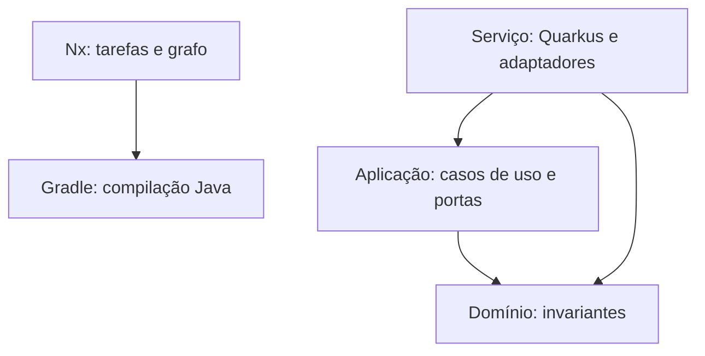

# Proposta técnica — Marketplace Nx

## Objetivo e base documental

Abrigar implementações do Marketplace em um monorepo com limites por contexto, build reproduzível e entrega independente por serviço. A referência de escopo é `prds.md`, fornecido no projeto, que enumera oito contextos. Os documentos de fundamentos, context mapping, autenticação, APIs, gRPC e deployment orientam a evolução; os livros de Quarkus e Enterprise Integration Patterns fundamentam a separação hexagonal e os padrões de integração. Os livros não são redistribuídos neste pacote.

Os documentos mais amplos descrevem contextos complementares, como avaliações e configuração white-label. Eles não foram confundidos com o escopo dos oito serviços do PRD consolidado; entram como módulos adicionais quando refinados.

## Organização

Cada contexto possui três projetos Java: domínio, aplicação e serviço. O serviço é a raiz de composição; contém os adaptadores e injeta implementações nas portas da aplicação. Não se criam bibliotecas separadas para cada adaptador antes de existir necessidade de reuso ou compilação independente.

O repositório contém 24 projetos Java e oito espaços de contratos. O catálogo publica em `contracts/catalog-inventory` o OpenAPI gerado do código e o JSON Schema dos eventos; nenhum contrato gera código ainda. Cada serviço pode ser empacotado e implantado separadamente. Compartilhar o repositório não implica uma release única.

## Ferramentas e responsabilidades

| Ferramenta | Responsabilidade | Decisão |
|---|---|---|
| Nx 24.0.4 | Seleção de projetos, dependências e cache de tarefas | Versão exata no npm lockfile |
| Java 21 | Linguagem e runtime JVM | Toolchain explícita |
| Quarkus 3.40.1.1 | REST, injeção, saúde e empacotamento | BOM e plugin alinhados |
| Gradle 9.7.0 | Build multiprojeto e testes Java | Wrapper oficial com checksum |
| JUnit/REST Assured | Testes de invariantes e HTTP | Versões governadas pelo BOM |
| PostgreSQL 16 | Persistência do catálogo | Dev Services em dev/test; imagem fixa no compose |
| Apache Kafka 4.2.0 | Eventos do catálogo | KRaft no compose; Dev Services em dev/test |
| Keycloak 26.8.1 | Provedor OIDC local | Realm de desenvolvimento versionado em `infra/keycloak` |
| Mandrel (GraalVM) | Executável nativo dos contêineres | Builder padrão do Quarkus, em contêiner (ADR 005) |
| Docker/Kubernetes/Helm | Empacotamento e implantação | Chart Helm do catálogo (ADR 018); sem provisionamento de cluster |

As versões Quarkus/Gradle vieram do gerador oficial em 05/11/2026. Nx foi consultado no registro npm. As versões são deliberadamente fixas; atualização exige validar a matriz em CI.

## Dependências e cache

O `@nx/gradle` lê do próprio Gradle, pelo plugin `dev.nx.gradle.project-graph`, os módulos Java, as dependências entre eles e as tarefas de cada um, e os registra como projetos e targets do Nx (ADR 025): uma alteração no domínio afeta aplicação e serviço sem `implicitDependencies` à mão. O verificador impede referências entre os oito contextos atuais e aceita `implicitDependencies` só para os contratos que o Gradle não enxerga.

O cache usa os inputs e outputs que o Gradle declara para cada tarefa, inclusive arquivos fora do projeto, como os contratos que o teste do catálogo lê. `assemble`, o target de `npm run build`, restaura o JAR das bibliotecas ou a distribuição `quarkus-app` do serviço. Testes restauram relatórios e resultados. Dados de integração externos, credenciais ou respostas de APIs não são entradas determinísticas: testes futuros que dependam desses recursos precisam de target separado sem cache.

Não configure builds concorrentes contra os mesmos diretórios Gradle. O padrão usa paralelismo 1 no Nx e limita workers Gradle; o modo batch do `@nx/gradle` (`--batch`) junta as tarefas numa invocação só do Gradle. A CI verifica todos os projetos com `run-many`. `nx affected` exige histórico Git com base e head confiáveis, o que no checkout da CI significa buscar o histórico completo. Exemplo: `npx nx affected -t test --base=origin/main --head=HEAD`.

O verificador de limites é estático e cobre as convenções deste pacote; não substitui análise de bytecode, detecção de reflexão ou política completa de dependências externas. Tags Nx documentam os limites; sozinhas não fiscalizam imports Java.

## Integrações previstas

PostgreSQL, Kafka e OIDC atendem o catálogo (ADRs 006, 007 e 013). RabbitMQ, MongoDB, Redis e gRPC constam nos materiais, mas não são conectados a serviços sem caso de uso. Evoluir por adaptadores de cada contexto. Persistência pertence ao contexto; evitar entidades ORM compartilhadas e joins entre bases de serviços.

Eventos públicos devem ter identificador, versão, tenant, instante, correlação e payload; sua publicação deve ocorrer com outbox transacional quando houver banco, como no catálogo (ADR 013). Consumidores devem tratar duplicidade com inbox/idempotência. Saga coordena transições entre contextos; não transforma várias transações locais em transação distribuída ACID.

Pagamentos e repasses exigem contrato explícito de confirmação: o PRD distingue autorização de captura, porém usa nomes diferentes entre `PaymentConfirmed` e `PaymentCaptured`. Refinar esse contrato antes de implementar a saga. Também separar a verdade operacional do provedor financeiro do ledger interno e definir qual contexto comanda a liberação do escrow.

O tenant e a loja vêm de JWT validado (ADR 007); validar a loja contra a organização autorizada cabe ao contexto de identidade. O contexto também se propaga em mensagens e trabalhos assíncronos: os eventos do catálogo levam tenant e correlação no envelope. Testar acesso cruzado entre tenants em cada adaptador de persistência.

## Implantação e limites

Containers/Kubernetes seguem os documentos deste Marketplace. A implantação serverless exige decisão própria (ADR 005). O núcleo Java facilita criar adaptadores AWS posteriormente, mas não elimina mudanças em transporte, ciclo de execução ou operação.

O catálogo é implantado em Kubernetes pelo Helm chart `infra/helm/catalog-inventory` (ADR 018): duas réplicas por padrão, que o serviço suporta (ADRs 012 e 013), banco, Kafka e JWT configurados por valores, segredos referenciados a Secrets existentes e um Job que cria os tópicos Kafka antes de cada instalação ou upgrade. O chart não provisiona cluster, banco, Kafka nem provedor OIDC e não inclui ingresso, TLS nem políticas de rede; sem a configuração de banco, Kafka e JWT, ele não renderiza.

## Referências oficiais consultadas

- https://nx.dev/docs/reference/project-configuration
- https://nx.dev/docs/reference/inputs
- https://nx.dev/docs/features/cache-task-results
- https://quarkus.io/guides/gradle-tooling/
- https://quarkus.io/releases/
- https://docs.gradle.org/current/userguide/gradle_wrapper.html
- https://code.quarkus.io/
